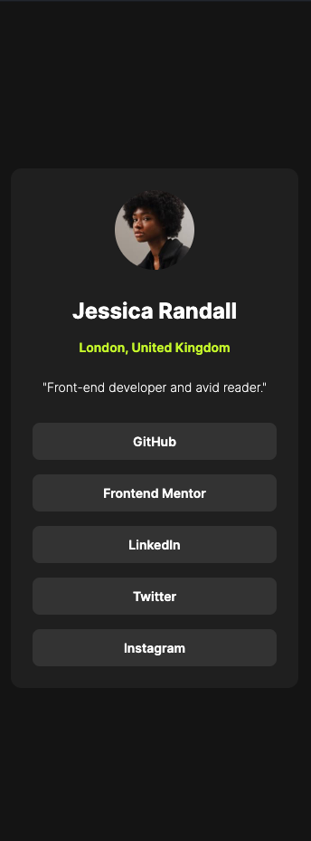

# Frontend Mentor - Social links profile solution

This is a solution to the [Social links profile challenge on Frontend Mentor](https://www.frontendmentor.io/challenges/social-links-profile-UG32l9m6dQ). Frontend Mentor challenges help you improve your coding skills by building realistic projects.

## Table of contents

- [Overview](#overview)
  - [The challenge](#the-challenge)
  - [Screenshot](#screenshot)
  - [Links](#links)
- [My process](#my-process)
  - [Built with](#built-with)
  - [What I learned](#what-i-learned)
  - [Useful resources](#useful-resources)
- [Author](#author)

## Overview

### The challenge

Users should be able to:

- See hover and focus states for all interactive elements on the page

### Screenshot



_Replace `screenshot.jpg` with your own screenshot of the finished page (Firefox's right-click → "Take Screenshot" works well). If you'd rather not include one, delete this section._

### Links

- Solution URL: [Add solution URL here](https://your-solution-url.com)
- Live Site URL: [Add live site URL here](https://your-live-site-url.com)

## My process

### Built with

- Semantic HTML5 markup (`main`, `h1`, `address`, `nav`, `ul` for the links)
- CSS with Flexbox (`flex-direction: column` card layout)
- CSS unit `100svh` for a resilient centered page on mobile
- `:focus-visible` styling to match the hover state for keyboard users
- Local Inter variable font

### What I learned

The trickiest part was getting the social buttons to stretch to the card's full width. Two CSS behaviors stood out:

1. `width` is ignored on inline elements — an `<a>` defaults to `display: inline`, so it needs `display: block` before a width does anything:

```css
.button {
  display: block;
  width: 100%;
}
```

2. `align-items: center` stops flex children from stretching. When I wrapped the links in a `<nav>`, the nav shrank to fit its content, so the width had to be given back to it:

```css
.social-container > nav {
  width: 100%;
}
```

I also learned that semantic markup isn't just for looks: wrapping the links in `nav` changed how the CSS behaved, and made the page easier for screen readers to navigate at the same time.

### Continued development

- Practice using CSS custom properties (`--green`, `--grey-800`…) instead of repeating HSL values
- Move the CSS out of `<style>` into a separate `styles.css`
- Compare the build against the Figma design file for exact spacing values

### Useful resources

- [The Markdown Guide](https://www.markdownguide.org/) - handy when writing this README
- [MDN: CSS display](https://developer.mozilla.org/en-US/docs/Web/CSS/display) - explains why `width` is ignored on inline elements

## Author

- Frontend Mentor - [@edrismazhari](https://www.frontendmentor.io/profile/edrismazhari)

_Credits to update with your real profile username, website, and social links._
